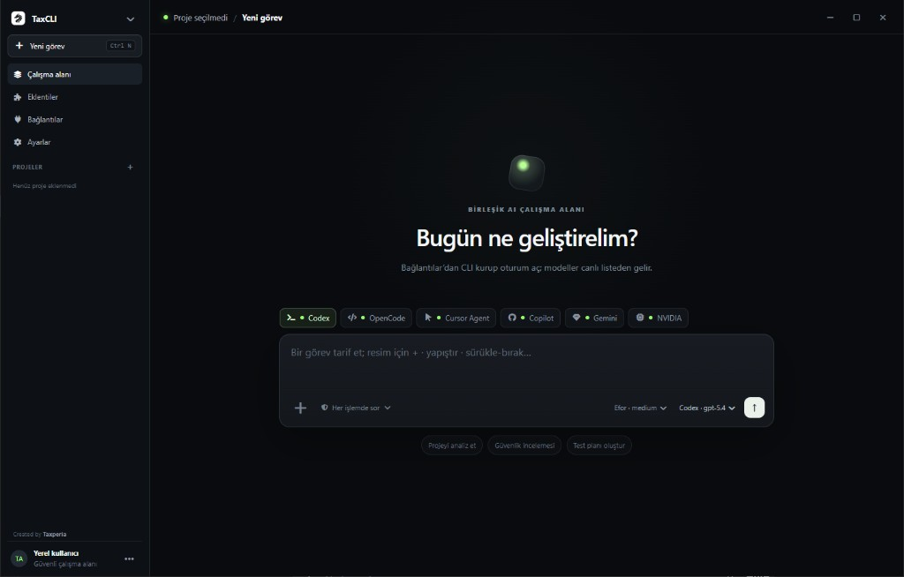

<div align="center">
  
  <h1>TaxCLI</h1>
  <p><strong>Your AI coding CLIs. One focused Windows workspace.</strong></p>
  <p>Run Codex, Claude Code, OpenCode, Cursor Agent, GitHub Copilot, Gemini CLI, and NVIDIA-backed models without juggling terminal windows.</p>

  <p>
    <a href="https://github.com/Taxperia/TaxCLI/releases/latest"></a>
    <a href="https://github.com/Taxperia/TaxCLI/releases"></a>
    
    <a href="https://github.com/Taxperia/TaxCLI/actions/workflows/ci.yml"></a>
    
  </p>

  <p>
    <a href="https://github.com/Taxperia/TaxCLI/releases/latest"><strong>Download for Windows</strong></a>
    ·
    <a href="#run-from-source">Build from source</a>
    ·
    <a href="docs/CLI-ROADMAP.md">Roadmap</a>
    ·
    <a href="SECURITY.md">Security</a>
  </p>
</div>

<p align="center">
  
</p>

> [!WARNING]
> This project is an early alpha and can start local processes with access to your selected project. Use test repositories, review agent permissions, and read the [security notes](SECURITY.md) before using real credentials.

## One workspace, multiple agents

AI coding agents are powerful, but each ships with a different command, login flow, model list, output format, and project memory convention. TaxCLI keeps the official CLIs as the execution layer while providing one local interface for projects, prompts, model selection, streaming output, history, and agent instructions.

It is local-first: agent processes run on your computer and use the accounts or API keys configured for their own CLIs. TaxCLI is not an AI model and does not proxy prompts through a TaxCLI server.

### Why use it?

- **Stay in context** — switch engines and models without leaving the active project.
- **Keep control** — choose ask, edit, or plan-oriented approval behavior and stop running processes.
- **Bring your own accounts** — TaxCLI launches the provider CLIs already installed and authenticated on your computer.

## Highlights

- Choose an expert profile independently from the provider: Smart routing, Planner, Everyday Assistant, Coder, or Deep Analyst
- Route prompts automatically by intent while keeping a manual agent override in the composer
- Apply provider plan/read-only controls for the Planner profile where the selected CLI supports them
- Use provider-local Auto or Global Auto across connected Codex, Claude Code, Gemini, NVIDIA, OpenCode, Cursor, and Copilot engines
- Optimize automatic runs for Economy, Balanced, or Quality; Economy also reduces carried conversation context and reasoning effort
- Detect installed Codex, Claude Code, OpenCode, Cursor Agent, GitHub Copilot, and Gemini CLIs
- Start the official CLI installer from Connections when a selected engine is missing
- Launch official login flows and inspect available authentication state
- Run supported agents inside a selected project and stop active processes
- Stream structured provider events into a desktop conversation
- Select multiple models from the same provider in blind, isolated Multi-AI comparisons
- Inspect per-file and per-hunk changes, accept reviews, reject changes, apply isolated solutions, and restore a run with conflict checks and safety snapshots
- Compare solutions in Model Arena with automatic project tests, a separate anonymous judge, and measured speed, reported cost, test and quality scores
- Inspect durable run timelines and replay runs with their recorded provider, model, effort and context settings
- Run reusable task recipes, project health checks, isolated conversation branches and project-scoped knowledge documents
- Import local CLI conversation exports and diagnose provider installation, authentication and model catalogs
- Keep project-scoped conversation history on the local machine
- Generate shared project memory plus `AGENTS.md`, `CLAUDE.md`, `GEMINI.md`, Cursor rules, and Copilot instructions
- Open an integrated PowerShell session for the selected project
- Attach local images to supported agent runs
- Pair a phone with a one-use QR code and send prompts from the local network
- Run an AI Office with a manager and parallel developer, designer, research, security, or review agents
- Delegate work through a manager-led subagent queue with bounded concurrency
- Inspect per-engine and per-model usage, estimated credits, duration, success, and file edits
- Connect Cloudflare with an encrypted read-only API token to inspect accounts and zones
- Customize in-app keyboard shortcuts and review persistent task/update notifications
- Automatically check GitHub Releases on startup and every six hours, download updates in the background, and restart to install when ready
- Connect multiple ChatGPT accounts and assign a different account to each Codex office employee
- Create automatic or manual project snapshots and restore them with a pre-restore safety point
- Queue durable project tasks, pause the queue, retry failures, and resume interrupted work after restart
- Review Git status, stage/unstage files, initialize repositories, inspect recent commits, and commit from Git Center
- Add permission-labelled, version-pinned MCP templates from the curated MCP marketplace
- Review workspace trust, encrypted secrets, security controls, and hash-chained audit events in Security Center
- Use an experimental embedded browser and plugin surface

Some adapters and UI surfaces remain experimental. See the [roadmap](docs/CLI-ROADMAP.md) for the distinction between the current desktop MVP and the planned command-line product.

## Get TaxCLI

### Download for Windows

Download the latest installer from [GitHub Releases](https://github.com/Taxperia/TaxCLI/releases/latest).

Installed builds check for updates after startup and every six hours and download available updates in the background. **Settings → General → Install and restart** applies a downloaded update when no agent task is running. Development builds do not auto-update.

The v0.1.1 installer is a manual, unsigned release. Download it from GitHub Releases; an automatic-update manifest is not published for this unsigned build.

> The alpha installer is not yet code-signed and may trigger Windows SmartScreen. Verify that the installer comes from the official `Taxperia/TaxCLI` release page.

### Requirements

- Windows 10 or later
- At least one supported AI coding CLI installed and authenticated
- Node.js 22.13 or later only when building from source

Agent subscriptions, usage fees, and API keys are managed by their respective providers. This project is not affiliated with OpenAI, Google, GitHub, Microsoft, Anysphere, NVIDIA, or the OpenCode maintainers.

## Run from source

```powershell
# Clone or download this repository, then open it:
cd path\to\TaxCLI
npm ci
npm start
```

Check JavaScript syntax without starting Electron:

```powershell
npm run check
npm test
```

## Supported engines

- **Codex** — authentication status, model handling, and structured run streaming
- **OpenCode** — authentication, live model discovery, and structured run streaming
- **Cursor Agent** — local detection, login, and runtime adapter
- **GitHub Copilot** — GitHub authentication, model discovery, and runtime adapter
- **Claude Code** — official CLI installation, Anthropic authentication, current model aliases, and structured run streaming
- **Gemini CLI** — API-key or local authentication, model selection, and runtime adapter
- **NVIDIA models** — API-key configuration through the OpenCode execution path

Provider CLIs evolve independently. Please include the provider CLI version when reporting adapter bugs.

## How it works

1. Add a local project folder.
2. TaxCLI detects supported CLIs and their authentication state.
3. Pick an expert agent (or Smart routing), engine, model, approval mode, and prompt.
4. Choose a fixed model, provider-local Auto, or **All AI engines**. Auto runs follow the Economy, Balanced, or Quality policy.
5. TaxCLI applies the selected specialist behavior and displays the actual engine, model, and reasoning effort chosen for the run.
6. The official provider CLI runs locally inside your project while TaxCLI renders its events in one interface.

## Mobile access

Open **Settings → Mobile access → Connect with QR**, then scan the code with your phone. The phone and computer must be on the same Wi-Fi or local network. Select a saved project, provider, model and approval mode on the phone, send a task, and follow the answer while it streams. Mobile tasks create separate conversations without changing the desktop's open conversation or draft.

Tap the project pill at the top to open project selection. The model name opens a separate provider/model panel, and the shield opens only approval-mode selection. The plus button offers task shortcuts that append a suggested prompt to the current draft without sending it. Connection refresh and sign-out are in the top-right menu. Enter adds a new line; use the send button or Ctrl/Cmd+Enter to submit. Assistant responses include a copy button.

- Pairing links expire after five minutes and can be used once.
- Paired devices receive a revocable, seven-day local session.
- Each phone keeps its own project, provider, model and approval-mode preferences. Projects must already be trusted and providers installed and authenticated on the desktop.
- Select **Ask**, **Auto edit**, or **Plan / read-only** for the task; the provider's existing permission restrictions still apply.
- Provider approval requests for a phone's tasks can be accepted once or declined from that phone or the desktop. Answering on either screen dismisses the request on both.
- Use **Close sessions** to sign every phone out, or **Turn off** to stop listening on the network.

This version is LAN-only and uses HTTPS with an app-generated, DPAPI-protected self-signed certificate. The phone can show a certificate warning on first connection; compare the SHA-256 fingerprint shown on the phone with TaxCLI before accepting it. Never expose the bridge with router port forwarding. A publicly trusted relay, VPN, or native client with certificate pinning is still required for safe use across the internet.

## AI Office

Choose **+ → AI Office** in the composer to create a reusable team. Each employee can have a custom name, avatar, role, engine, model, and working instructions.

An office run has three stages:

1. The manager reads the goal and assigns a focused deliverable to every available employee.
2. Employees run concurrently in isolated project copies, so two coding agents do not overwrite the same files.
3. The manager compares their reports, inspects useful variants, applies the best combined solution to the main project, and runs final verification.

Read-only roles such as security, research, and review cannot modify their project copy. Developer and designer roles can implement changes according to the current approval policy. Image creation depends on the selected provider's tools; without a native image tool, the designer produces usable SVG/CSS assets or an image-generation brief instead of pretending an image was generated.

### Multiple ChatGPT accounts

Inside **AI Office → ChatGPT accounts**, choose **Continue with ChatGPT** for every account you want to add. The browser completes OpenAI's PKCE sign-in flow. Then select the desired account in each Codex employee card. Two Codex employees can use separate accounts concurrently; employees left on **Default Codex session** continue using the machine's normal Codex CLI login.

ChatGPT access, refresh, and retained identity tokens are encrypted with Electron `safeStorage` (Windows DPAPI) and are never exposed to the renderer, logs, project folders, or child processes other than the selected employee's short-lived access token. Removing an account attempts to revoke its renewable OpenAI session before deleting the local encrypted record.

## Project memory

The memory generator creates `.aihub/` as a shared source of project context and adds provider-specific instruction files only when they do not already exist. Generated files should still be reviewed before committing them.

## Development Center

Open **Geliştirme merkezi** in the sidebar for the review, arena, run recorder, recipes, health, branches, knowledge and session-import panels. See the [Turkish usage guide](docs/GELISTIRME-MERKEZI.md).

Multi-AI comparisons capture one immutable starting state. Only one candidate copy exists at a time: its result is encrypted before the copy is removed and the next candidate starts. Automatic tests run before cleanup. A separately selected read-only judge receives anonymous patches and test evidence. No candidate changes the main project until the user applies selected files or hunks. Missing test commands or unreported billing remain explicitly unknown rather than being counted as passes or zero cost.

Select comparison models from one searchable dropdown, grouped by provider with a provider icon on every model. Pick several models from the same provider and remove individual selections using their chips. The judge model is configured under the expandable judge section.

## Automatic updates

Installed Windows builds check the configured `Taxperia/TaxCLI` GitHub Releases feed after startup and every six hours. Stable updates download automatically; **Settings → General → Install and restart** applies a downloaded update when no agent task is running. Development builds do not download or install updates.

For a new release, set the package version and matching existing `vMAJOR.MINOR.PATCH` tag. The Release workflow runs on a tag push or can be started manually with that tag. Configure `WIN_CSC_LINK` and `WIN_CSC_KEY_PASSWORD` in repository Actions secrets for Windows signing. CI checks the signature and verifies `latest.yml` against the exact installer bytes, uploads all assets to a draft, then publishes the complete release. It does not overwrite an existing published version.

Without signing credentials, the signed publication job is skipped. A manual installer can be built with `npm run dist -- --publish never`; label it unsigned and omit `latest.yml` from its public assets. Release notes live in `docs/releases/`.

This provides application-level blind comparison, not a VM/container boundary against a hostile local process. Native provider CLIs still run under the user's OS account and their own permission controls. Provider event timelines likewise reflect reported tools and commands, not a complete OS-level access audit.

Conversation branches work in persistent independent copies. Import transfers conversation messages from supported JSON/JSONL formats or terminal text exports; it does not migrate a running process or hidden provider tool state. Knowledge documents, including text PDFs, are stored encrypted locally and selected text is sent to the chosen provider when used. Health checks execute the trusted project's own scripts; dependency auditing and outdated-package checks require the explicit network checkbox.

## Security and privacy

- TaxCLI can execute commands and modify files through installed agent CLIs.
- Provider API keys, custom vault values, and multi-account ChatGPT tokens use Windows-backed `safeStorage` encryption; legacy plaintext provider keys are migrated on first read.
- Agent and terminal access requires explicit workspace trust. Snapshot and parallel-copy code excludes credentials, links, dependency/build folders, and oversized files.
- The embedded browser denies OS permissions, downloads, popups, and non-HTTP navigation. Canva and Drive request confirmation before leaving their approved domain sets.
- Security-sensitive output is redacted, high-risk terminal commands are blocked, browser content is treated as untrusted, and audit events are hash-chained.
- Conversation history and project paths are stored locally.

The prioritized hardening plan is in [Security Hardening](docs/SECURITY-HARDENING.md). Please report vulnerabilities privately as described in [SECURITY.md](SECURITY.md).

## Documentation

- [CLI and distribution roadmap](docs/CLI-ROADMAP.md)
- [Security hardening ideas](docs/SECURITY-HARDENING.md)
- [GitHub launch, naming, description, and topics](docs/GITHUB-LAUNCH.md)
- [Changelog](CHANGELOG.md)
- [Contributing guide](CONTRIBUTING.md)
- [Code of Conduct](CODE_OF_CONDUCT.md)

## Contributing

Issues and focused pull requests are welcome. Start with [CONTRIBUTING.md](CONTRIBUTING.md), and avoid posting secrets or security vulnerabilities in public issues.

## License

Copyright © 2026 [Taxperia](https://github.com/Taxperia).

The source is available under the [Taxperia Non-Commercial Attribution License](LICENSE). Non-commercial use and modification are permitted with visible attribution. Commercial use requires a separate written license from Taxperia. This is a source-available license and is not an OSI-approved open-source license.

Bundled dependencies and assets retain their own licenses; see [Third-Party Notices](THIRD_PARTY_NOTICES.md).
